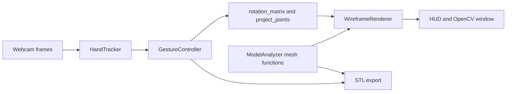

# HoloForge

**A Webcam-Driven Spatial Computing and Holographic CAD Platform**

[](https://www.python.org/)
[](https://opencv.org/)
[](https://mediapipe.dev/)
[](tests/)
[

HoloForge tracks hand gestures through a webcam to manipulate, inspect, and export
3D meshes as a real-time holographic-style wireframe.

```text
+------------------------------------------------+
| FPS: 35.0                                      |
| Pinch: 0.213                                   |
| Palm: (0.512, 0.478)                           |
| State: GRABBED                                 |
| Mode: ROTATE                                   |
| Scale: 1.00x                                   |
| Model: sculpture.obj                           |
| Faces: 12,000                                  |
| Rendered Edges: 5,000                          |
| LOD: 2,500 @ 6.1px                             |
+------------------------------------------------+
```

## Table of Contents

- [The Vision](#the-vision)
- [Feature Matrix](#feature-matrix)
- [Architecture](#architecture)
- [Mathematics and Rendering Notes](#mathematics-and-rendering-notes)
- [Controls](#controls)
- [Quick Start](#quick-start)
- [Photogrammetry Workflow](#photogrammetry-workflow)
- [Performance and Testing](#performance-and-testing)
- [Known Limitations](#known-limitations)
- [Roadmap](#roadmap)
- [Comparison](#comparison)
- [Examiner Notes and Citations](#examiner-notes-and-citations)
- [License](#license)
- [Author](#author)

## The Vision

SpaceX's 2013 “The Future of Design” demonstration presented a designer reaching
into a spatial interface to shape a vehicle. The Iron Man interface popularized
the same visual language: a person manipulates a projected model with direct,
unencumbered gestures. HoloForge is an academic reconstruction of that interaction
using equipment available to a student: a webcam, a laptop, and an open-source
software stack. MediaPipe estimates hand landmarks from each video frame; pinch
and palm motion control a projected mesh, while two hands change its scale and
screen position. The renderer draws perspective-projected edges with depth cues
and level-of-detail selection. Imported photogrammetry meshes can be inspected,
analysed for geometric properties, and exported as transformed STL files. The
project does not claim spatial display or volumetric imaging: “holographic” here
describes the visual treatment of a conventional 2D camera frame. The goal is to
make the interaction pipeline and its engineering tradeoffs inspectable in code.

## Feature Matrix

| Feature | Technique | Module |
|---|---|---|
| Hand detection | Tasks VIDEO; 640x480; two hands; all confidences 0.7 | `hand_tracker.py` |
| Pinch grab | Hysteresis: grab below 0.35; release above 0.50 | `GrabDetector` |
| Palm smoothing | Exponential moving average, alpha 0.2 | `Smoother` in `hand_tracker.py` |
| One-hand rotation | Friction TAU 0.35 s; spin-and-catch | `GestureController` |
| Two-hand transform | Enter after 3 frames; exit after 5 absent frames | `GestureController` |
| Projection | `Rz @ Ry @ Rx`; focal length 2000; offset 1500; min depth 1 | `projection_3d.py` |
| Wireframe rendering | Glow plus three depth bins; four polyline calls | `wireframe_renderer.py` |
| Render LOD | Edge ladder 5000/2500/1200/600; 8 px upgrade, 4 px downgrade | `WireframeRenderer` |
| Vertex markers | Drawn only at or below 600 active edges | `WireframeRenderer` |
| Mesh loading | `trimesh`; quadric 5000 faces or random 5000 edges | `model_analyzer.py` |
| Mesh preparation | Centre at origin and normalise to 150-unit size | `model_analyzer.py` |
| Mesh analysis | Volume, area, extents, centre of mass, watertight, winding | `compute_metrics` |
| PLA estimate | Density assumption 1.24 g/cm3 | `compute_metrics` |
| STL export | Timestamped STL; rotation and scale, no screen pan | `export_transformed_mesh` |
| CLI | `python -m src.main [--model PATH] [--frame-skip N]` | `src/main.py` |

## Architecture



ASCII fallback:

```text
Webcam -> HandTracker -> GestureController -> projection -> renderer -> HUD
                                                    ^             ^
                                                    |             |
                                       model_analyzer +-----> export (STL)
```

Repository layout:

```text
HoloForge/
|-- assets/models/          Imported OBJ, PLY, or STL meshes
|-- models/                 MediaPipe hand_landmarker.task (downloaded)
|-- output/                 Timestamped STL exports
|-- scripts/setup_windows.bat
|-- src/
|   |-- analysis/model_analyzer.py
|   |-- interaction/gesture_controller.py
|   |-- rendering/projection_3d.py
|   |-- rendering/wireframe_renderer.py
|   |-- vision/hand_tracker.py
|   `-- main.py
|-- tests/
|-- requirements.txt
`-- README.md
```

## Mathematics and Rendering Notes

### Rotation and projection

`rotation_matrix` composes right-handed rotations as `Rz @ Ry @ Rx`. `project_points`
rotates and scales vertices, adds `Z_OFFSET=1500` to depth, clamps depth at
`MIN_Z=1`, and applies the pinhole factor `FOCAL_LENGTH=2000 / depth`. Screen
coordinates are centred in the frame, then shifted by the controller offset.

### Hysteresis and smoothing

`GrabDetector.update` enters grab below pinch ratio 0.35 and releases above 0.50;
values in between preserve the previous state. `Smoother.update` applies an EMA
with alpha 0.2. `GestureController.update_two_hands` enters transform after 3
consecutive two-hand frames and exits after 5 absent frames.

### Z-binned LOD glow

`WireframeRenderer.render` draws a glow pass and far, middle, and near depth bins
using four batched `cv2.polylines` calls at most. `_select_lod_level` uses edge
targets 5000, 2500, 1200, and 600, moving one rung when mean edge length crosses
8 px or 4 px. `stroke_rules` limits vertex dots to 600 edges or fewer.

## Controls

| Input | Action | Notes |
|---|---|---|
| Pinch and move one hand | Rotate model | Grab below 0.35; palm delta drives velocity |
| Release pinch | Continue spin | Exponential friction; re-pinch catches current motion |
| Move two palms apart/together | Scale model | Scale is clamped between 0.5x and 3.0x |
| Move two palms together | Pan model | Two-hand mode has enter/exit hysteresis |
| Arrow keys | Rotate model | 5 degrees per key press |
| `+` / `-` | Change scale | 0.1 per press |
| `r` | Reset pose | Rotation, scale, and pan return to defaults |
| `a` | Toggle analysis panel | Requires a mesh loaded with `--model` |
| `e` | Export transformed mesh | Requires `--model`; writes an STL in `output/` |
| `q` | Quit | Closes the camera window |
| `--frame-skip N` | Inference cadence | Run every N frames; minimum is 1 |

## Quick Start

### PowerShell

```powershell
python -m venv .venv
.\.venv\Scripts\Activate.ps1
python -m pip install -r requirements.txt
New-Item -ItemType Directory -Force models | Out-Null
Invoke-WebRequest `
  -Uri "https://storage.googleapis.com/mediapipe-models/hand_landmarker/hand_landmarker/float16/1/hand_landmarker.task" `
  -OutFile "models/hand_landmarker.task"
```

Generate a sample icosphere with trimesh, then run the application:

```powershell
python -c "import trimesh as t; t.creation.icosphere().export('assets/models/icosphere.obj')"
python -m src.main --model assets/models/icosphere.obj --frame-skip 2
```

Expected startup messages (camera index and measurements depend on the machine):

```text
INFO HoloForge: HoloForge v0.1.0 - Initializing...
INFO HoloForge: Phase 1: Vision pipeline [COMPLETE]
INFO HoloForge: Opened camera index 0 at 640x480
INFO HoloForge: Hand-tracking loop running on camera; press 'q' to exit
INFO HoloForge: Stage latencies: inference 18.20 ms, render 5.50 ms
```

### Bash

```bash
python3 -m venv .venv
source .venv/bin/activate
python -m pip install -r requirements.txt
mkdir -p models assets/models
curl -L "https://storage.googleapis.com/mediapipe-models/hand_landmarker/hand_landmarker/float16/1/hand_landmarker.task" \
  -o models/hand_landmarker.task
```

```bash
python -c "import trimesh as t; t.creation.icosphere().export('assets/models/icosphere.obj')"
python -m src.main --model assets/models/icosphere.obj --frame-skip 2
```

Alternatively, Windows users can run `scripts/setup_windows.bat` to create the
environment, install requirements, and download the hand model.

## Photogrammetry Workflow

1. Capture overlapping photos of an object with a phone, including its full
   surface and useful detail from multiple angles.
2. Reconstruct a mesh with Meshroom or Polycam using the captured images.
3. Export an OBJ mesh and place it in `assets/models/`.
4. Start HoloForge with `python -m src.main --model assets/models/scan.obj`.
5. Inspect the scan and press `e` to write a transformed STL under `output/`.

The webcam is used for interaction only; it is never used to capture the scan.

## Performance and Testing

Measured on the project reference setup: approximately 35 FPS at 640x480;
inference EMA of 12–23 ms with `--frame-skip 2`; rendering around 5.5 ms.
Results vary with hardware, camera, model complexity, and lighting.

Tests run headlessly without opening a webcam or GUI. The suite covers gesture
state, projection, mesh loading and analysis, LOD selection, and a pixel-count
visibility regression guard.

```powershell
.venv\Scripts\python.exe -m pytest tests/
```

The current collection contains 76 tests.

## Known Limitations

- Hand inference uses CPU execution in the current application setup.
- Two-hand tracking can fail when hands overlap or leave the webcam's field of view.
- The renderer has no true Z-buffer; depth bins provide visual ordering cues only.
- Scan quality depends on capture coverage, focus, lighting, and reconstruction settings.
- Shiny, transparent, or featureless objects can fail photogrammetry reconstruction.
- The projected “hologram” is drawn into a conventional 2D webcam frame.

## Roadmap

### Completed releases

| Tag | Delivered |
|---|---|
| `v0.1.0` | Vision pipeline |
| `v0.2.0` | Interaction engine |
| `v0.3.0` | Mesh pipeline |
| `v0.4.0` | Analysis and export |

### Future work

- VR headset presentation and tracked controller support.
- Voice commands for common model and interface actions.
- Multi-user interaction and session coordination.

## Comparison

| Dimension | HoloForge | SpaceX 2013 demonstration |
|---|---|---|
| Input device | Consumer webcam and bare-hand gestures | Custom motion-sensing interface |
| CAD backend | Python projection and trimesh mesh processing | Integrated vehicle-design workflow |
| Display | Monitor with 2D camera overlay | Large spatial display |
| Manufacturing route | STL export for fabrication | Aerospace manufacturing |
| Cost | Open-source; webcam and computer required | Industrial setup; cost not stated |

## Examiner Notes and Citations

HoloForge separates capture, landmark inference, gesture state, projection,
rendering, mesh analysis, and export into testable modules. Its output is a
perspective wireframe overlay rather than a volumetric display. Geometry and
manufacturing estimates are intended for inspection and demonstration; they do
not replace validation in a CAD or slicer workflow. The SpaceX comparison is
limited to the cited 2013 demonstration and makes no claim about its underlying
proprietary implementation.

- SpaceX, [“The Future of Design” (2013)](https://www.youtube.com/watch?v=9c6W4CCU9M4)
- Google, [MediaPipe Hand Landmarker](https://ai.google.dev/edge/mediapipe/solutions/vision/hand_landmarker)
- Trimesh, [documentation](https://trimesh.org/)
- OpenCV, [documentation](https://docs.opencv.org/)
- NumPy, [documentation](https://numpy.org/doc/)

## License

MIT. See [LICENSE](LICENSE).

## Author

Suvam, BCA undergraduate.
